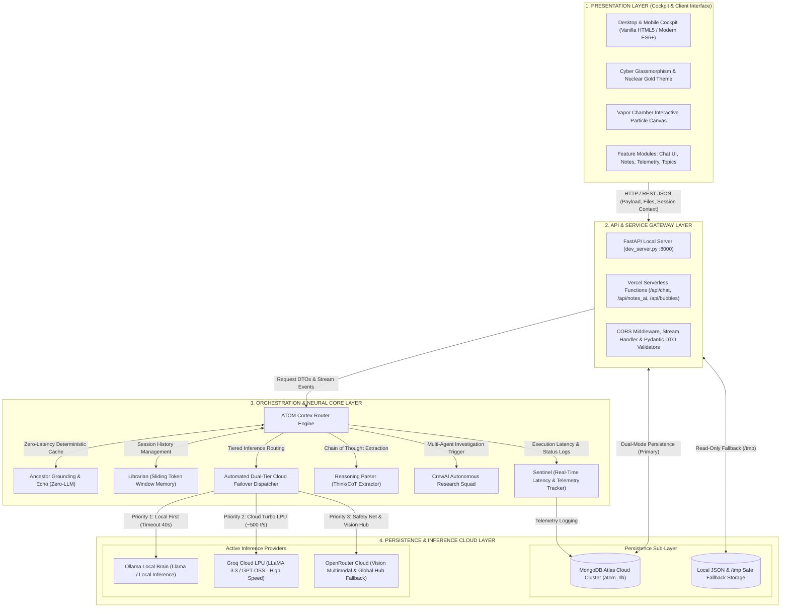
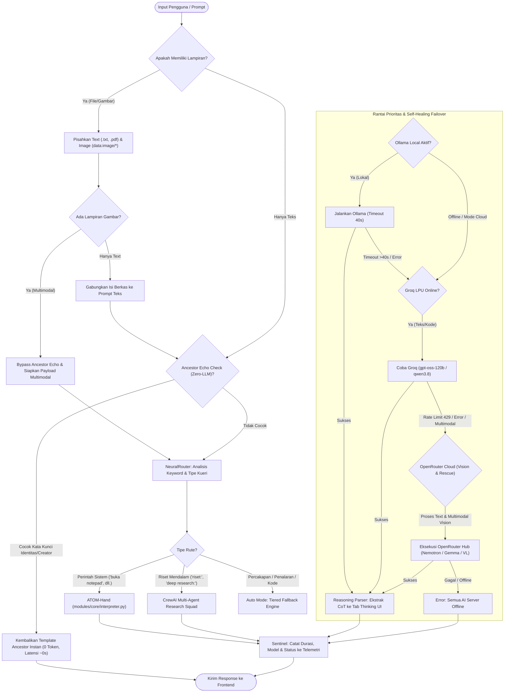
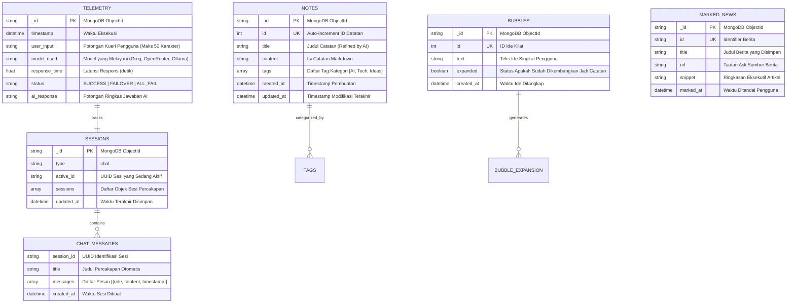

# ⚛️ Laporan Arsitektur & Spesifikasi Diagram Sistem A.T.O.M. v4.0

> Dokumen ini memuat diagram Mermaid teknis, skema data, dan **Prompt Visual Generator Gambar AI** yang siap disalin untuk menghasilkan aset ilustrasi profesional.

---

## 📑 Daftar Isi
1. [Diagram Arsitektur Sistem (4 Lapisan / 4-Tier Architecture)](#1-diagram-arsitektur-sistem-4-tier-architecture)
   - [Diagram Mermaid Arsitektur Sistem](#11-diagram-mermaid-arsitektur-sistem)
   - [Prompt Siap Salin ke Image Generator (Arsitektur 4-Layer)](#12-prompt-siap-salin-ke-image-generator-arsitektur-4-layer)
2. [Diagram Alur Kerja Cortex Neural Router (Failover & Routing Engine)](#2-diagram-alur-kerja-cortex-neural-router)
   - [Diagram Mermaid Alur Kerja Cortex](#21-diagram-mermaid-alur-kerja-cortex)
   - [Prompt Siap Salin ke Image Generator (Alur Cortex Router)](#22-prompt-siap-salin-ke-image-generator-alur-cortex-router)
3. [Skema Hubungan Basis Data (MongoDB Atlas & Fallback Store)](#3-skema-hubungan-basis-data-mongodb-atlas)
   - [Diagram Mermaid Entity-Relationship (ERD Document Schema)](#31-diagram-mermaid-entity-relationship-erd)
   - [Prompt Siap Salin ke Image Generator (Database Schema ERD)](#32-prompt-siap-salin-ke-image-generator-database-schema-erd)
4. [Tabel Komparasi & Parameter Teknis Provider Aktif](#4-tabel-komparasi--parameter-teknis-provider-aktif)

---

## 1. Diagram Arsitektur Sistem (4-Tier Architecture)

Arsitektur A.T.O.M. v4.0 dirancang dengan memisahkan antarmuka taktis berbobot ringan (*Zero UI Overhead*) dari mesin orkestrasi berdaya tahan tinggi (*Resilience & Failover Layer*).

### 1.1. Diagram Mermaid Arsitektur Sistem



---

### 1.2. Prompt Siap Salin ke Image Generator (Arsitektur 4-Layer)

#### 📋 Prompt Bahasa Inggris:
```text
A high-tech, ultra-detailed architectural system diagram infographic of an AI platform named "A.T.O.M. v4.0", shown as 4 distinct floating horizontal layers in an isometric 3D perspective.

Dark obsidian background (#000000) with subtle warm amber gold accents (#ebb338), cyber glassmorphism frosted glass panels, hairline neon borders, and clean technological data lines connecting each tier.

The 4 stacked layers from top to bottom:
1. TOP LAYER: "PRESENTATION LAYER" - Glowing translucent glass dashboard showing chat UI, code windows, note blocks, and radioactive vapor chamber particles.
2. SECOND LAYER: "API & GATEWAY LAYER" - Microservices nodes labeled "FastAPI Gateway", "Vercel Serverless Functions", and "Pydantic DTO Pipeline".
3. THIRD LAYER: "ORCHESTRATION & NEURAL CORE" - A central glowing golden processor labeled "CORTEX ROUTER", surrounded by interconnected satellite chips: "Librarian Memory", "Sentinel Telemetry", "Ancestor Grounding", and "CrewAI Squad".
4. BOTTOM LAYER: "PERSISTENCE & INFERENCE CLOUD" - Split into two sections: on the left, a glowing green/gold database cylinder labeled "MongoDB Atlas Cluster", and on the right, floating cloud compute badges labeled "Ollama Local", "Groq LPU (Speed Engine)", and "OpenRouter (Vision & Hub Rescue)".

Style: Enterprise software architecture diagram, clean technical vector art, isometric 3D render, glowing data pipelines, highly legible labels, Unreal Engine 5 aesthetic, sleek matte finish, no visual clutter, 8k resolution.
```

#### 📋 Prompt Bahasa Indonesia:
```text
Infografis diagram arsitektur sistem perangkat lunak modern tingkat enterprise untuk platform AI "A.T.O.M. v4.0". Ditampilkan dalam 4 lapisan bertingkat isometrik melayang dengan latar belakang hitam pekat obsidian dan aksen warna emas nuklir (nuclear gold #ebb338).

Desain bertema Cyber Glassmorphism dengan panel kaca buram matte, garis pembatas neon presisi tipis, dan pipa aliran data yang bersinar.

4 Lapisan dari atas ke bawah:
1. Lapisan 1 (Atas): "Presentation Layer" - Kokpit dashboard web responsif, antarmuka chat cerdas, panel catatan zettelkasten, dan partikel canvas.
2. Lapisan 2: "API & Service Gateway" - Node server FastAPI, Vercel Serverless Functions, dan validasi data Pydantic.
3. Lapisan 3: "Neural Core & Cortex Router" - Unit pemroses orkestrator pusat berwarna emas bercahaya, dikelilingi modul Librarian (Memori), Sentinel (Telemetri), Ancestor Engine, dan CrewAI Multi-Agent.
4. Lapisan 4 (Bawah): "Persistence & Inference Layer" - Silinder database MongoDB Atlas di sisi kiri, serta server komputasi aktif di sisi kanan bertuliskan "Ollama Local", "Groq LPU (Speed Engine)", dan "OpenRouter (Vision & Rescue Fallback)".

Gaya: Diagram teknis modern, infografis 3D isometrik, pencahayaan matte presisi tanpa silau berlebihan, tipografi tajam, resolusi tinggi 8K.
```

---

## 2. Diagram Alur Kerja Cortex Neural Router

### 2.1. Diagram Mermaid Alur Kerja Cortex



---

### 2.2. Prompt Siap Salin ke Image Generator (Alur Cortex Router)

#### 📋 Prompt Bahasa Inggris:
```text
A sleek, futuristic decision flowchart diagram illustrating the "CORTEX NEURAL ROUTER" decision logic for an AI routing engine.

Layout: Flowchart starting from the top node "User Input / Multimodal Prompt" splitting into parallel decision pathways on a dark obsidian background (#000000) with amber gold (#ebb338) and neon cyan connecting circuit tracks.

Key stages depicted as glowing rectangular circuit blocks:
1. Input Parsing: "File & Vision Detector" detecting images vs text.
2. Fast Path: "Ancestor Echo (Deterministic Zero-LLM Cache)" glowing green with "0ms Instant Return".
3. Dispatcher Split: Branching into "Physical Action", "CrewAI Multi-Agent Squad", and "Neural Fallback Chain".
4. The Streamlined Fallback Ladder: A descending priority waterfall showing:
   - Priority 1: "Ollama Local (40s Watchdog Timer)"
   - Priority 2: "Groq LPU (Ultra-Fast ~500 tok/s LLaMA 3.3 / GPT-OSS)"
   - Priority 3: "OpenRouter Cloud Hub (Multimodal Vision & Fallback Safety Anchor)"
5. Output Stage: "Sentinel Telemetry Logger" converging into the final response bubble.

Style: High-tech cybernetic circuit flowchart, glowing nodes, clean vector iconography, modern typography, glassmorphism badge cards, highly organized infographic style, 8k resolution.
```

#### 📋 Prompt Bahasa Indonesia:
```text
Diagram alur (flowchart) teknis futuristik yang menggambarkan logika kerja "CORTEX NEURAL ROUTER" pada sistem kecerdasan buatan.

Tampilan dengan latar belakang gelap pekat (#000000) berhiaskan jalur sirkuit emas (#ebb338) dan aksen biru sian:
1. Bagian Atas: Simpul input "Kueri Pengguna & Detektor Gambar Multimodal".
2. Jalur Cepat: Kotak bercahaya hijau "Ancestor Echo (Zero-LLM)" yang langsung membalikkan respons instan untuk pertanyaan identitas sistem.
3. Percabangan Rute: Memisahkan instruksi ke "ATOM Hand (Aksi Sistem Lokal)", "CrewAI Research Squad", dan "Rantai Fallback AI".
4. Tangga Prioritas Pemulihan (Failover):
   - Prioritas 1: Ollama Lokal (Batas waktu 40 detik).
   - Prioritas 2: Groq LPU (Kecepatan turbo 500 token/detik untuk teks dan kode).
   - Prioritas 3: OpenRouter Cloud (Jaring pengaman pemulihan utama & pemroses gambar multimodal).
5. Bagian Akhir: Blok "Modul Sentinel" yang mencatat latensi dan model ke database telemetri.

Gaya: Infografis alur data teknologi tinggi, kartu kaca transparan (glassmorphism), garis penunjuk arah neon yang bersih dan presisi, resolusi tinggi 8K.
```

---

## 3. Skema Hubungan Basis Data (MongoDB Atlas)

Sistem A.T.O.M. menggunakan database dokumen **MongoDB Atlas** (`atom_db`) dengan struktur hybrid dokumen bebas skema (*flexible document collections*) yang didukung oleh *safe fallback* lokal jika koneksi internet atau hak akses berkas terganggu.

### 3.1. Diagram Mermaid Entity-Relationship (ERD Document Schema)



---

### 3.2. Prompt Siap Salin ke Image Generator (Database Schema ERD)

#### 📋 Prompt Bahasa Inggris:
```text
A clean, elegant technical Entity-Relationship Diagram (ERD) and database architecture schema for a cloud database named "atom_db on MongoDB Atlas".

Rendered on an ultra-dark navy/obsidian matte backdrop with warm amber-gold table headers and cybernetic cyan connector lines showing entity relationships.

Depicted as 5 modular database collection cards with glowing frosted glass styling:
1. "sessions" Collection: fields include _id (PK), type (chat), active_id, sessions array, updated_at.
2. "notes" Collection: fields include _id, id (UK), title, content (Markdown), tags array, created_at, updated_at.
3. "bubbles" Collection: fields include _id, id (UK), text, expanded (Boolean), created_at.
4. "telemetry" Collection: fields include _id, timestamp, user_input, model_used, response_time (float), status (SUCCESS/FAILOVER).
5. "marked_news" Collection: fields include _id, id, title, url, snippet, marked_at.

Between the tables, show elegant curved data relation lines with fork notations (one-to-many relationship connectors). On the top corner, display a glowing MongoDB leaf badge and an "Offline Local JSON /tmp Fallback" redundancy icon.

Style: Modern developer database diagram, Vercel/Linear design style, high contrast, sharp text typography, vector blueprint aesthetic, 8K resolution.
```

#### 📋 Prompt Bahasa Indonesia:
```text
Diagram skema basis data Entity-Relationship (ERD) teknis untuk database cloud "atom_db (MongoDB Atlas)".

Tampilan berlatar belakang gelap obsidian matte dengan kartu tabel kaca transparan (glassmorphism), header tabel berwarna emas reaktor (#ebb338), dan garis relasi antartabel berwarna biru cyan.

Menampilkan 5 entitas koleksi data utama:
1. Koleksi "sessions": Menyimpan riwayat multi-sesi obrolan chat.
2. Koleksi "notes": Menyimpan catatan terstruktur zettelkasten, tag pencarian, dan artikel markdown.
3. Koleksi "bubbles": Menyimpan tangkapan ide kilat (concept bubbles) dan status ekspansi.
4. Koleksi "telemetry": Menyimpan data pemantauan real-time seperti nama model, durasi respon (detik), dan status failover.
5. Koleksi "marked_news": Menyimpan artikel dan wawasan teknologi yang ditandai pengguna.

Terdapat garis penghubung relasi one-to-many yang rapi di antara tabel, serta ikon indikator proteksi penyimpanan lokal mandiri (/tmp).

Gaya: Diagram skema database profesional, estetika antarmuka modern developer, garis vektor tajam, resolusi tinggi 8K.
```

---

## 4. Tabel Komparasi & Parameter Teknis Provider Aktif

| Parameter | Ollama (Lokal) | Groq Cloud | OpenRouter Cloud |
| :--- | :--- | :--- | :--- |
| **Peran di Cortex** | Prioritas 1 (Local First) | Prioritas 2 (Cloud Turbo Speed) | Prioritas 3 (Multimodal Vision & Safety Anchor) |
| **Kelebihan Utama** | Privasi 100%, Bebas Kuota Cloud | Kecepatan Eksekusi LPU (~500 t/s) | Katalog Model Luas & Dukungan Vision |
| **Model Default** | `llama3.2` / `qwen2.5` | `openai/gpt-oss-120b`, `qwen/qwen3.8-27b` | `nvidia/nemotron-3.5-super-vl:free`, `google/gemma-4-31b-it:free` |
| **Batas Timeout** | **40 Detik** (Hard Stop Watchdog) | 15 Detik (HTTP Timeout) | 15 Detik (HTTP Timeout) |
| **Pemicu Failover** | Timeout >40s / Daemon Mati | Kuota 429 / Server Busy / Ada Gambar | Jaring pengaman akhir jika Groq terkendala |
